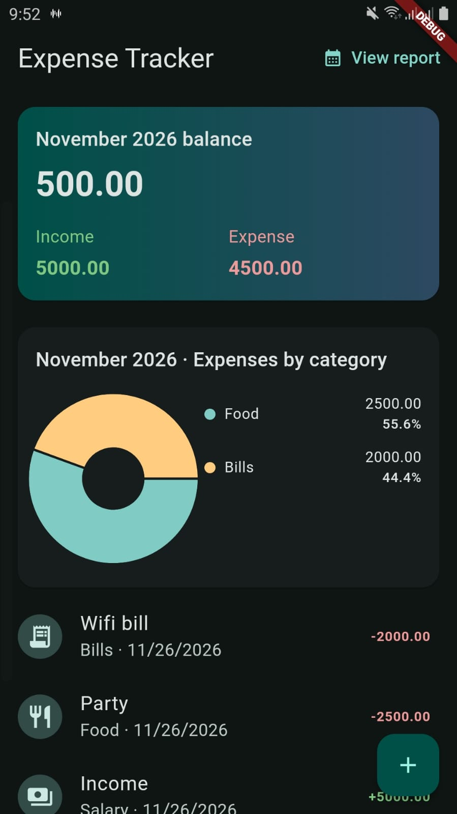
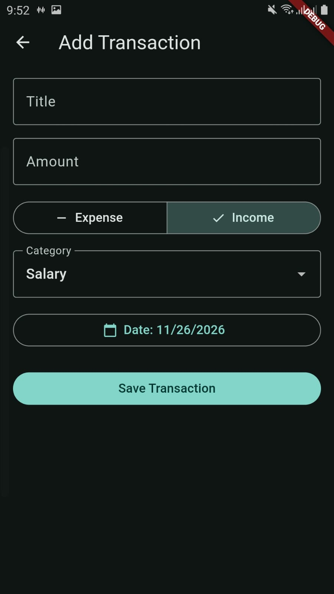
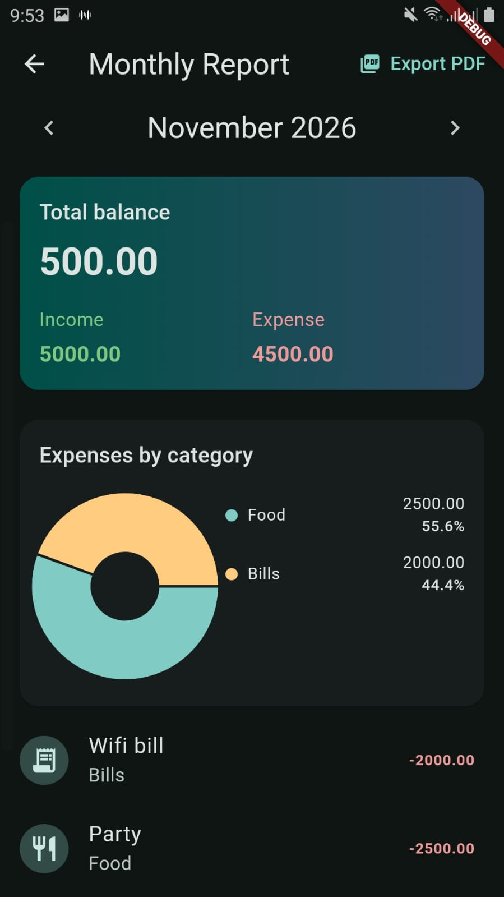
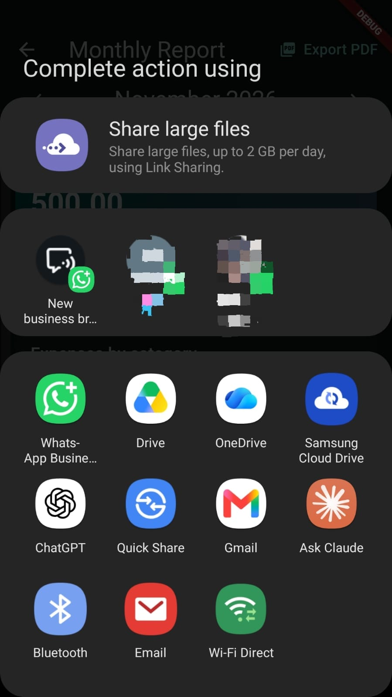

# Expense Tracker Pro

A Flutter application for tracking income and expenses with local reporting and PDF export.

## Features

- Add, edit, and delete income or expense transactions
- View expenses grouped by category in a pie chart
- Browse monthly income, expense, balance, and transaction reports
- Export monthly reports as PDF files
- Store transactions offline in SQLite
- Use light or dark themes based on the system theme

## Tech Stack

- Flutter
- Provider
- sqflite
- fl_chart
- pdf

## Architecture

- `lib/models/` contains the transaction data model
- `lib/db/` contains the SQLite database helper
- `lib/providers/` contains state management and transaction operations
- `lib/screens/` contains the home, transaction entry/editing, and monthly report screens
- `lib/widgets/` contains reusable UI components

Screens never touch the database directly. They communicate with `TransactionProvider`, which owns the `DatabaseHelper`, loads and updates transaction state, and notifies listeners after database operations. This keeps SQLite access out of UI code and ensures screens render state managed through Provider.

## Screenshots

### Home



### Add or edit transaction



### Monthly report



### PDF export



## How to Run

```sh
flutter pub get
flutter run
```
